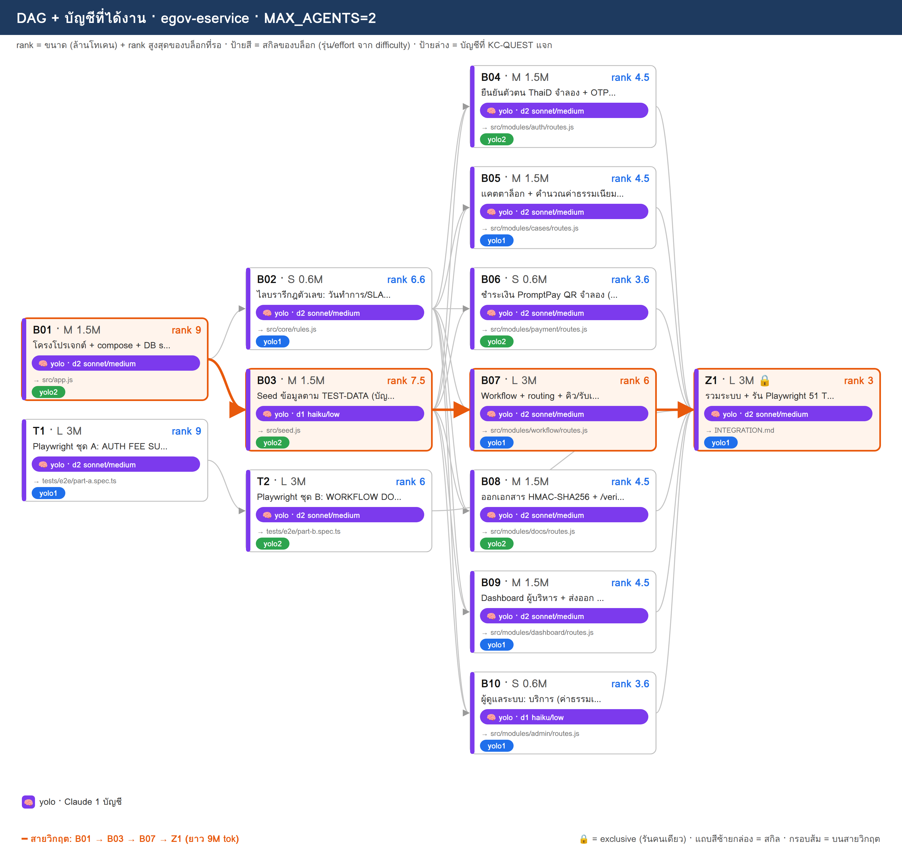
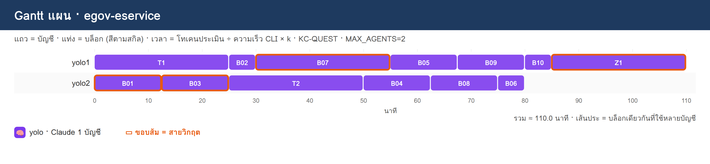

# PLAN · egov-eservice

**โจทย์:** เว็บ e-Service กลาง เทศบาลนครตัวอย่าง (สมมติ) ตามชุดโจทย์ /workspace/egov-brief · Node.js 20 + Express + SQLite รันด้วย docker compose คำสั่งเดียว · รองรับ TEST_MODE=1 และ BUG_MODE ตาม BUGS.md · มี Playwright ครบ 51 TC · ทุกบล็อกทำตามสเปกใน /workspace/plans/egov-eservice/app/SPEC/ ที่สถาปนิกเขียนไว้แล้ว ห้ามออกแบบใหม่ ถ้าสเปกไม่ชัดให้เพิ่มหัวข้อใน SPEC/QUESTIONS-<บล็อก>.md แล้วทำส่วนที่ชัดต่อ

วางแผนเมื่อ 16/11/2026 20:04 · MAX_AGENTS 2 · บัญชี yolo1, yolo2 · ตัวปรับเวลา k (ยังไม่มี calib.json → k=1)

> แผนนี้ยังไม่ได้รันจริง — KC-QUEST เลือกบัญชีจากโควตา แล้วจำลองเวลาตาม dependency

## 1) โควตาของแต่ละบัญชี

| บัญชี | แพลน | ใช้ไป 5 ชม. | ใช้ไปสัปดาห์ | headroom | รีเซ็ต/หมดอายุ (ชม.) | U | slot | ที่มา |
|---|---|---|---|---|---|---|---|---|
| yolo1 | default | 20% | 0% | **80%** | 168.0 | 0.125 | 3 | สมมติ (--accounts) |
| yolo2 | default | 41% | 0% | **59%** | 168.0 | 0.125 | 3 | สมมติ (--accounts) |

- ⚠ ทุกบัญชีเป็นค่าสมมติ (--accounts มี % ครบ) → ไม่ได้เรียก team.py check/quota

## 2) DAG + สกิล + บัญชี

**สายวิกฤต:** B01 → B03 → B07 → Z1 · ยาว 9M tok

## 3) ตารางแจกงาน (เหตุผล KC-QUEST ทุกบล็อก)

| บล็อก | สกิล | ชื่อ | ขนาด · c | รอ | rank | บัญชี (บทบาท) | เริ่ม–จบ (นาที) | เหตุผล KC-QUEST |
|---|---|---|---|---|---|---|---|---|
| **B01** | 🧠 yolo | โครงโปรเจกต์ + compose + DB schema + test hook + BUG_MODE + audit logger | M · 1.5 | – | 9 | yolo2 (ทำ) | 0.0–12.5 | ทำ: yolo2 28.4 (U=0.125 F=0.005 S=0.551 S=1.0 L=0.0) · 1.50M ≈ 5ชม. 3.9% / สัปดาห์ 0.49% · อันดับ 2 yolo1 27.0 |
| T1 | 🧠 yolo | Playwright ชุด A: AUTH FEE SUBMIT UPLOAD PAY QUEUE SLA NOTI (22 TC) | L · 3 | – | 9 | yolo1 (ทำ) | 0.0–25.0 | ทำ: yolo1 31.0 (U=0.125 F=0.01 S=0.722 S=1.0 L=0.0) · 3.00M ≈ 5ชม. 7.8% / สัปดาห์ 0.98% · อันดับ 2 yolo2 27.9 |
| **B03** | 🧠 yolo | Seed ข้อมูลตาม TEST-DATA (บัญชี บริการ วันหยุด 30+2 คำขอ เอกสาร ชำระเงิน คิว) | M · 1.5 | B01 | 7.5 | yolo2 (ทำ) | 12.5–25.0 | ทำ: yolo2 25.3 (U=0.125 F=0.005 S=0.512 S=0.833 L=0.0) · 1.50M ≈ 5ชม. 3.9% / สัปดาห์ 0.49% · อันดับ 2 yolo1 24.5 |
| B02 | 🧠 yolo | ไลบรารีกฎตัวเลข: วันทำการ/SLA · ค่าธรรมเนียม · checksum บัตร · ปิดบังเลข · เลขคำขอ · รูปแบบวันที่/เงิน | S · 0.6 | B01 | 6.6 | yolo1 (ทำ) | 25.0–30.0 | ทำ: yolo1 26.6 (U=0.125 F=0.002 S=0.706 S=0.733 L=0.0) · 0.60M ≈ 5ชม. 1.56% / สัปดาห์ 0.2% · อันดับ 2 yolo2 23.5 |
| T2 | 🧠 yolo | Playwright ชุด B: WORKFLOW DOC PDPA DASH AUDIT RBAC NFR (29 TC) | L · 3 | T1 | 6 | yolo2 (ทำ) | 25.0–50.0 | ทำ: yolo2 21.7 (U=0.125 F=0.01 S=0.434 S=0.667 L=0.0) · 3.00M ≈ 5ชม. 7.8% / สัปดาห์ 0.98% · อันดับ 2 yolo1 21.3 |
| **B07** | 🧠 yolo | Workflow + routing + คิว/รับเรื่อง (409) + ตีกลับ ≤2 + อนุมัติ/ไม่อนุมัติ + เวลาแก้ไข 168 ชม. + แจ้งเตือน SLA | L · 3 | B02, B03 | 6 | yolo1 (ทำ) | 30.0–55.0 | ทำ: yolo1 24.6 (U=0.125 F=0.01 S=0.628 S=0.667 L=0.0) · 3.00M ≈ 5ชม. 7.8% / สัปดาห์ 0.98% · อันดับ 2 yolo2 17.2 |
| B04 | 🧠 yolo | ยืนยันตัวตน ThaiD จำลอง + OTP lock + ลงทะเบียน + SSO เจ้าหน้าที่ + RBAC หน้า/API | M · 1.5 | B02, B03 | 4.5 | yolo2 (ทำ) | 50.0–62.5 | ทำ: yolo2 18.5 (U=0.125 F=0.005 S=0.395 S=0.5 L=0.0) · 1.50M ≈ 5ชม. 3.9% / สัปดาห์ 0.49% · อันดับ 2 yolo1 18.1 |
| B05 | 🧠 yolo | แคตตาล็อก + คำนวณค่าธรรมเนียม + ยื่นคำขอ/ร่าง/ยกเลิก + อัปโหลด (magic bytes · 5 MB · 5 ไฟล์) | M · 1.5 | B02, B03 | 4.5 | yolo1 (ทำ) | 55.0–67.5 | ทำ: yolo1 21.4 (U=0.125 F=0.005 S=0.589 S=0.5 L=0.0) · 1.50M ≈ 5ชม. 3.9% / สัปดาห์ 0.49% · อันดับ 2 yolo2 14.6 |
| B08 | 🧠 yolo | ออกเอกสาร HMAC-SHA256 + /verify + PDPA ปิดบัง/แสดงเลขเต็ม + หน้า Audit Trail (อ่านอย่างเดียว · 405) | M · 1.5 | B02, B03 | 4.5 | yolo2 (ทำ) | 62.5–75.0 | ทำ: yolo2 17.9 (U=0.125 F=0.005 S=0.356 S=0.5 L=0.0) · 1.50M ≈ 5ชม. 3.9% / สัปดาห์ 0.49% · อันดับ 2 yolo1 17.5 |
| B09 | 🧠 yolo | Dashboard ผู้บริหาร + ส่งออก Excel/PDF | M · 1.5 | B02, B03 | 4.5 | yolo1 (ทำ) | 67.5–80.0 | ทำ: yolo1 20.8 (U=0.125 F=0.005 S=0.55 S=0.5 L=0.0) · 1.50M ≈ 5ชม. 3.9% / สัปดาห์ 0.49% · อันดับ 2 yolo2 14.0 |
| B06 | 🧠 yolo | ชำระเงิน PromptPay QR จำลอง (อายุ <15:00 · ยอดพอดี · idempotent · เลข EG/RC ข้ามปี · ไม่ซ้ำเมื่อพร้อมกัน) | S · 0.6 | B02, B03 | 3.6 | yolo2 (ทำ) | 75.0–80.0 | ทำ: yolo2 16.1 (U=0.125 F=0.002 S=0.34 S=0.4 L=0.0) · 0.60M ≈ 5ชม. 1.56% / สัปดาห์ 0.2% · อันดับ 2 yolo1 15.7 |
| B10 | 🧠 yolo | ผู้ดูแลระบบ: บริการ (ค่าธรรมเนียม SLA) · วันหยุด · ผู้ใช้/บทบาท · ช่วงค่าที่ยอมรับ | S · 0.6 | B02, B03 | 3.6 | yolo1 (ทำ) | 80.0–85.0 | ทำ: yolo1 19.1 (U=0.125 F=0.002 S=0.535 S=0.4 L=0.0) · 0.60M ≈ 5ชม. 1.56% / สัปดาห์ 0.2% · อันดับ 2 yolo2 15.9 |
| **Z1** | 🧠 yolo | รวมระบบ + รัน Playwright 51 TC จนผ่าน + รัน BUG_MODE B01–B12 ทีละตัว | L · 3 | B03, B04, B05, B06, B07, B08, B09, B10, T2 | 3 | yolo1 (ทำ) | 85.0–110.0 | ทำ: yolo1 17.1 (U=0.125 F=0.01 S=0.457 S=0.333 L=0.0) · 3.00M ≈ 5ชม. 7.8% / สัปดาห์ 0.98% · อันดับ 2 yolo2 14.1 |

## 4) Gantt แผน

## 5) รอบแจกงาน

| นาทีที่ | บล็อกที่เริ่ม |
|---|---|
| 0 | T1→yolo1, B01→yolo2 |
| 12.5 | B03→yolo2 |
| 25 | B02→yolo1, T2→yolo2 |
| 30 | B07→yolo1 |
| 50 | B04→yolo2 |
| 55 | B05→yolo1 |
| 62.5 | B08→yolo2 |
| 67.5 | B09→yolo1 |
| 75 | B06→yolo2 |
| 80 | B10→yolo1 |
| 85 | Z1→yolo1 |

## 6) สรุป

- บล็อก 13 · แจกได้ 13 · agent พร้อมกันสูงสุด 2/2
- เวลาประมาณ 110.0 นาที (แท่ง Gantt) · ไฟล์ผลของทีม: `/workspace/plans/egov-eservice/app/`

ต่อไป: `dagplan.py export egov-eservice` → `dagplan.py run egov-eservice` → `dagplan.py report egov-eservice`
