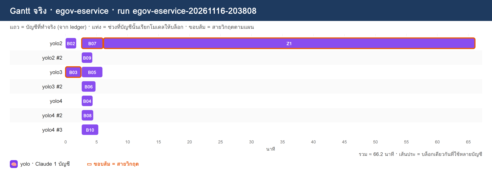
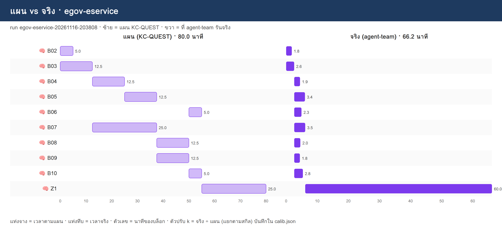

# REPORT · egov-eservice

**run:** `egov-eservice-20261116-203808` · `/workspace/.agent-team/egov-eservice-20261116-203808` · โจทย์: เว็บ e-Service กลาง เทศบาลนครตัวอย่าง (สมมติ) ตามชุดโจทย์ /workspace/egov-brief · Node.js 20 + Express + SQLite รันด้วย docker compose คำสั่งเดียว · รองรับ TEST_MODE=1 และ BUG_MODE ตาม BUGS.md · มี Playwright ครบ 51 TC · ทุกบล็อกทำตามสเปกใน /workspace/plans/egov-eservice/app/SPEC/ ที่สถาปนิกเขียนไว้แล้ว ห้ามออกแบบใหม่ ถ้าสเปกไม่ชัดให้เพิ่มหัวข้อใน SPEC/QUESTIONS-<บล็อก>.md แล้วทำส่วนที่ชัดต่อ · **วิธีตรวจในเครื่องนี้ (ใช้แทนคำสั่ง docker compose/พอร์ต 3000 ในตารางตรวจของสเปก):** image `egov-app:dev` build ไว้แล้ว (มี node_modules ครบ ห้ามเพิ่ม dependency) · รันตัวตรวจของบล็อกตัวเอง: `docker run --rm -d --name chk-<บล็อก> -e TEST_MODE=1 -e DB_PATH=/tmp/app.db -p <พอร์ต>:3000 -v $PWD/src:/app/src -v $PWD/tests:/app/tests egov-app:dev` (พอร์ต = 31 ตามด้วยเลขบล็อก เช่น B05 → 3105) แล้ว curl http://localhost:<พอร์ต> · แก้โค้ดแล้ว `docker restart chk-<บล็อก>` · จบแล้ว `docker rm -f chk-<บล็อก>` · unit test: `docker run --rm -v $PWD/src:/app/src -v $PWD/tests:/app/tests egov-app:dev node --test tests/unit/<ไฟล์>` · ห้าม docker compose down/up และห้ามแตะ container ของบล็อกอื่น (บล็อกอื่นรันขนานอยู่) · ถ้าต้อง build image ใหม่ใช้ `DOCKER_BUILDKIT=0 COMPOSE_DOCKER_CLI_BUILD=0` (BuildKit ล้มด้วย rosetta error) · B01 (โครง + src/core/*) เสร็จแล้ว ห้ามแก้ src/core ยกเว้นบล็อกเจ้าของ

## ตารางบล็อก (แผน vs จริง)

| บล็อก | สกิล | บัญชีแผน | บัญชีจริง | นาทีแผน | นาทีจริง | tokens (ไม่รวม cache read) | ครั้ง | สถานะ | ไฟล์ผล |
|---|---|---|---|---|---|---|---|---|---|
| B02 | 🧠 yolo | yolo3(ทำ) | yolo2(ทำ) | 5.00 | 1.82 | 73,173 | 1 | ok | ✅ src/core/rules.js |
| **B03** | 🧠 yolo | yolo2(ทำ) | yolo3(ทำ) | 12.50 | 2.58 | 130,858 | 1 | ok | ✅ src/seed.js |
| B04 | 🧠 yolo | yolo3(ทำ) | yolo4(ทำ) | 12.50 | 1.87 | 80,421 | 1 | ok | ✅ src/modules/auth/routes.js |
| B05 | 🧠 yolo | yolo2(ทำ) | yolo3(ทำ) | 12.50 | 3.45 | 118,327 | 1 | ok | ✅ src/modules/cases/routes.js |
| B06 | 🧠 yolo | yolo4(ทำ) | yolo3(ทำ) | 5.00 | 2.33 | 57,618 | 1 | ok | ✅ src/modules/payment/routes.js |
| **B07** | 🧠 yolo | yolo4(ทำ) | yolo2(ทำ) | 25.00 | 3.53 | 104,050 | 1 | ok | ✅ src/modules/workflow/routes.js |
| B08 | 🧠 yolo | yolo3(ทำ) | yolo4(ทำ) | 12.50 | 1.97 | 71,810 | 1 | ok | ✅ src/modules/docs/routes.js |
| B09 | 🧠 yolo | yolo2(ทำ) | yolo2(ทำ) | 12.50 | 1.82 | 52,339 | 1 | ok | ✅ src/modules/dashboard/routes.js |
| B10 | 🧠 yolo | yolo3(ทำ) | yolo4(ทำ) | 5.00 | 2.78 | 93,559 | 1 | ok | ✅ src/modules/admin/routes.js |
| **Z1** | 🧠 yolo | yolo4(ทำ) | yolo2(ทำ) | 25.00 | 60.03 | 195,387 | 1 | failed — timeout after 3600s | ❌ INTEGRATION.md |

- tokens รวมของบล็อก **977,542** = ผลรวมจาก ledger ของ run (10 การเรียก) **977,542** ✅ ตรงกัน
- การเรียกที่ไม่ใช่บล็อก (ตรวจความพร้อม ฯลฯ): 0 ครั้ง · 0 tokens (ไม่นับในตาราง)
- เวลารวม: แผน 80.0 นาที · จริง 66.2 นาที
- บล็อกเสร็จ 9/10

## ภาพ

## ความต่างระหว่างแผนกับของจริง

- B02: แผน yolo3(ทำ) → จริง yolo2(ทำ)
- B03: แผน yolo2(ทำ) → จริง yolo3(ทำ)
- B04: แผน yolo3(ทำ) → จริง yolo4(ทำ)
- B05: แผน yolo2(ทำ) → จริง yolo3(ทำ)
- B06: แผน yolo4(ทำ) → จริง yolo3(ทำ)
- B07: แผน yolo4(ทำ) → จริง yolo2(ทำ)
- B08: แผน yolo3(ทำ) → จริง yolo4(ทำ)
- B10: แผน yolo3(ทำ) → จริง yolo4(ทำ)
- Z1: แผน yolo4(ทำ) → จริง yolo2(ทำ)
- (export ส่งเป็นฝั่ง yolo/cyolo ไม่ผูกบัญชี เพื่อให้ failover ของ agent-team ทำงาน → agent-team เลือกบัญชีในฝั่งเองตามโหลด/โควตา ดู references/run.md)

## ตัวปรับเวลา k (calib.json)

`/workspace/plans/calib.json`: {"yolo": 0.2161}

k = นาทีจริง ÷ นาทีแผน (ก่อนคูณ k) แยกตามสกิล · `plan` ครั้งถัดไปคูณเวลาแต่ละบล็อกด้วย k ของสกิลนั้น

## หมายเหตุจากกลุ่ม (เพิ่มเอง)
- **S1-SPEC รันนอก DAG:** ก่อนรอบนี้ใช้ yolo1 (opus/xhigh) เขียนสเปก `SPEC/` 54 นาที (19:09–20:03) แล้วให้บล็อกช่างใช้ sonnet/haiku ทำตามสเปก เพื่อประหยัดโทเคน · เวลานี้จึงไม่อยู่ใน Gantt
- **รอบ 1 (`egov-eservice-20261116-201853`):** T1 ✔ 7.2 นาที · T2 ✔ 7.6 นาที · B01 ✘ timeout 600 วินาที (ค่าเริ่มต้นของ dag-planner) ตอน build image · ตรวจเองแล้ว health/reset ผ่าน จึงไม่รัน B01 ซ้ำ
- **build ใน container:** BuildKit ล้ม (`rosetta error` ของการจำลอง amd64 บน Mac) → ใช้ `DOCKER_BUILDKIT=0 COMPOSE_DOCKER_CLI_BUILD=0`
- **รอบ 2:** B02–B10 เสร็จบล็อกละ 2–3.5 นาที (k = 0.22 → เร็วกว่าแผนราว 5 เท่า เพราะสเปกตัดสินใจแทนช่างแล้ว) · **Z1 ✘ timeout 3600 วินาที:** รัน Playwright ชุดเต็ม 4 รอบ (รอบละ ~13 นาทีใต้การจำลอง amd64 + วิดีโอ/trace ทุกข้อ) แก้ `src/core/views.js` `workflow/pages.js` · ไม่ทันเขียน INTEGRATION.md และรอบ BUG_MODE → ทำต่อในขั้น 4–5 บนเครื่อง host
- บัญชี yolo2/yolo3/yolo4 เป็น subscription เดียวกัน · yolo1 ใช้กับ S1
